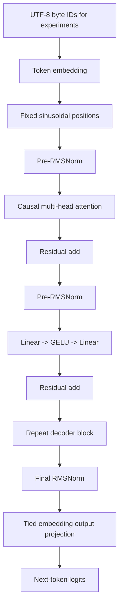

# BitForge-300M

A locally runnable, BitNet-inspired Transformer research system for studying
ternary quantization-aware training, compact checkpoints, and CUDA execution.
The full **297,059,328-parameter model has executed on CPU and an RTX 4060
Laptop GPU**. It is randomly initialized and has never been pretrained.
A separate **1,378,176-parameter model** is trained on offline synthetic CC0 text
for the inference demonstration.

Ternary weights take values `{-alpha, 0, +alpha}`. Storing their codes uses two
bits per eligible weight instead of 32. This implementation keeps FP32 master
weights during QAT and reconstructs dense floating-point tensors when loading
packed files. **There are no native ternary GPU kernels.**

## Table of contents

- [Project highlights](#project-highlights)
- [Verified results](#verified-results)
- [Quick start](#quick-start)
- [Architecture](#architecture)
- [Install and run offline](#install-and-run-offline)
- [QAT and checkpoint format](#qat-and-checkpoint-format)
- [Tests and reproducibility](#tests-and-reproducibility)
- [Limitations and next work](#limitations-and-next-work)

## Project highlights

| Full-model parameters | Checkpoint compression | Median CUDA forward | Automated tests |
|---:|---:|---:|---:|
| **297.06M** | **6.02×** | **49.09 ms** (batch 1, context 8) | **74 passing** |

The full 297M model is untrained; the separate 1.38M demo model was trained
for 600 updates on synthetic CC0 text. These figures summarize the verified
results and measurement conditions below.

## Verified results

| Item | Actual result |
|---|---|
| Full architecture | 297,059,328 real parameters; CPU and CUDA finite forward |
| Full forward shape | `[1, 8, 32000]`, batch 1, context 8 |
| Full CUDA QAT FP32 peak | 1,442,173,952 allocated / 1,495,269,376 reserved bytes |
| Full CUDA QAT FP32 median | 49.09 ms, 2 warm-ups and 5 timed forwards |
| Full dense master file | 1,188,291,675 bytes |
| Full packed file | 197,365,045 bytes; **6.0208x** measured compression |
| Full packed reconstruction | CPU error 0; CUDA maximum absolute logit error 2.03e-6 |
| Earlier 1.378M checkpoint | **10.2076x** measured compression (Milestone 6) |
| Trained demo | 600 updates; validation CE 2.2972, byte perplexity 9.9464 |
| Paired QAT comparison | Three seeds, 100 updates each; no consistent quality improvement |
| Earlier training memory optimization | 120.8 to 91.5 MiB allocated; BF16 + SDPA + checkpointing |
| Release tests | 71 ordinary + 3 real full-model tests passed; 0 failures, 0 skips |

Full forward and memory values above refer to the ternary QAT model, FP32
weights/execution, SDPA, sequence length 8, Windows 11 / Python 3.13.7 /
PyTorch 2.7.1+cu118. Packed files load to frozen dense projections, so their
runtime measurements are listed separately in the
[final technical report](docs/final-technical-report.md) and
[benchmark CSV](artifacts/release-summary-final/benchmarks.csv).
Compression does not imply proportional VRAM savings or native low-bit speed.
Short laptop timings vary with power state and other workloads.

## Quick start

On Windows, use CPython 3.13 and the verified PyTorch 2.7.1+cu118 environment.
Follow [Windows setup](docs/windows-setup.md) to prepare dependencies from a
compatible offline wheelhouse. With network access, the repository setup script
installs the pinned environment and verifies CUDA and tests:

```powershell
powershell.exe -NoProfile -ExecutionPolicy Bypass -File .\scripts\setup.ps1
.\.venv\Scripts\Activate.ps1
```

From the repository root in the prepared environment, generate the trained
**1.38M demo checkpoint** offline, then run the CLI demonstration. Use a new
output directory; checkpoint binaries are not included in Git. The 600-update
run trains only the small demo, not the untrained 297M full model. CUDA is
required for this reproduction path.

```powershell
python scripts/prepare_engineering_corpus.py
python experiments/release_demo.py --output-dir artifacts/portfolio-demo --steps 600
python -m bitforge demo --checkpoint artifacts/portfolio-demo/demo.bft --device cuda --prompt "The technician will " --max-new-tokens 32
```

See the [demonstration walkthrough](docs/portfolio-demo.md) for the presentation
sequence and evidence to show. The recorded demonstration is not yet published.
Demo output is repetitive and demonstrates the pipeline rather than general
language ability.

## Architecture



| Setting | Trained experiment | Full architecture |
|---|---:|---:|
| Vocabulary/output dimension | 259 byte/special IDs | 32,000 |
| Width | 192 | 1,024 |
| Blocks | 3 | 24 |
| Attention heads | 6 | 16 |
| FFN width | 768 | 3,328 |
| Configured context | 64 | 2,048 |
| Unique parameters, tied output | 1,378,176 | 297,059,328 |
| Training status | 600 demo updates; paired 100-step research runs | Zero updates |

The full configuration has 32,768,000 embedding/head, 100,663,296 attention,
163,577,856 FFN, and 50,176 norm parameters. It is inspired by BitNet's ternary
projection idea and extends this repository's decoder; it is not a reproduction
of a published BitNet model. Only the byte tokenizer is implemented. The 32K
full-size head is an architectural target, without a trained 32K tokenizer.
Full generation restricts sampling to byte IDs and is a smoke test.

## Install and run offline

Use the existing Python 3.13 / PyTorch 2.7.1 environment:

```powershell
.\.venv\Scripts\Activate.ps1
python -m pip install --no-index --no-deps --no-build-isolation -e .
python -m bitforge --help
```

See [Windows setup](docs/windows-setup.md) for prepared offline wheels and
hardware requirements. No datasets, weights, or Internet calls are needed at
inference time. Checkpoint binaries are generated locally and ignored by Git;
a fresh clone must create them first:

```powershell
python scripts/prepare_engineering_corpus.py
python experiments/release_demo.py --output-dir artifacts/my-demo --steps 600
python -m bitforge demo --checkpoint artifacts/my-demo/demo.bft --device cuda --prompt "The technician will " --max-new-tokens 32
```

For the already verified local artifacts:

```powershell
python -m bitforge model-info --checkpoint artifacts/release-demo-final/demo.pt
python -m bitforge generate --checkpoint artifacts/release-demo-final/demo.pt --device cpu --prompt "The technician will " --max-new-tokens 32 --verbose
python -m bitforge generate --checkpoint artifacts/release-demo-final/demo.bft --device cuda --prompt "The technician will " --temperature 0.8 --top-k 40 --top-p 0.9 --seed 42 --max-new-tokens 32
python -m bitforge verify-checkpoint --checkpoint artifacts/release-demo-final/demo.bft --reference artifacts/release-demo-final/demo.pt --device cuda
python -m bitforge benchmark --checkpoint artifacts/release-full-final/full.bft --device cuda --sequence-length 8 --warmup 2 --repeats 5 --generation-tokens 2
python -m bitforge demo --checkpoint artifacts/release-full-final/full.bft --device cuda --prompt "The " --max-new-tokens 2
```

Temperature 0 is greedy; positive temperature supports seeded top-k and top-p
sampling. CPU and CUDA are supported. BF16 autocast is CUDA-only. Missing,
corrupt, and incompatible files fail with a readable error and exit code 2.
Config-bearing historical training checkpoints remain readable.

## QAT and checkpoint format

`BitLinear` preserves the original absmean ternary baseline and identity
straight-through estimator. `LeastSquaresBitLinear` alternates scale least
squares and nearest ternary assignment four times from that baseline. Each
coordinate step reduces weight reconstruction error, up to floating-point
rounding. That property does not imply improved language-model loss: the
three-seed comparison found essentially equal validation losses and extra cost.
FP32 embeddings, norms, activations, and optimizer state are not ternary.

Packed v1 (original) and v2 (improved quantizer) use a bounded JSON manifest,
two-bit projection codes, FP32 scales and non-quantized tensors, per-tensor and
whole-container SHA-256 checks. Loading verifies dimensions, architecture,
quantizer, shape, finite values, offsets, padding and integrity before assigning
weights. It creates frozen dense projections to avoid accidental requantization.
Checksums detect corruption; they are not signatures. Dense local files use
`torch.load(weights_only=True)` with strict state validation.

The full packed file is less compressed than the small model because its large
floating-point embedding/head remains unpacked. CPU/GPU QAT reductions can
change codes near rounding thresholds; packed files fix their source-device
codes. This device effect is reported separately from reconstruction error.

## Tests and reproducibility

```powershell
python -m unittest discover -s tests -v
python -m unittest discover -s tests/expensive -v
python scripts/run_release_tests.py --include-full --output artifacts/my-test-results.json
$env:CUBLAS_WORKSPACE_CONFIG = ':4096:8'
python experiments/release_full_model.py --output-dir artifacts/my-full --threads 4
```

The full runner constructs one real model at a time, checks available RAM/VRAM
and disk before allocation/writes, performs bounded inference, and exports and
reloads the full-size files. It never starts full-size training. Use a new output
directory for each run; previous checkpoints are preserved. Expensive tests
are opt-in and run real full-size CPU/CUDA forwards and packed export/reload.

- [Exact reproduction commands and measurement conditions](docs/reproducibility.md)
- [Final technical report and acceptance gates](docs/final-technical-report.md)
- [Measured JSON summary](artifacts/release-summary-final/summary.json)
- [Full experiment evidence](artifacts/release-full-final/results.json)
- [Identical dense/packed runtime comparison](artifacts/release-full-storage/results.json)
- [Test counts and complete logs](artifacts/release-tests-final.json)
- [2-4 minute portfolio demonstration](docs/portfolio-demo.md)
- [Release checklist](docs/release-checklist.md)
- [Milestones 1-8 history](docs/milestones-1-8-readme.md) and [6](docs/milestone-6.md), [7](docs/milestone-7.md), [8](docs/milestone-8.md)

## Limitations and next work

The full model is untrained. Only batch 1 / short-context inference has been
validated at full size; full training and long-context capacity are unverified.
Synthetic templates overlap across train/validation, and the demo output is
repetitive. Neither perplexity nor random full-model output establishes general
language competence. No external evaluation corpus or pretrained weights were
used. Corpus provenance, license and hashes are in the data manifest.

Packed storage expands into dense FP32 runtime weights. BF16 autocast retains
those weights and can increase peak memory at tiny contexts. Native ternary
kernels, streaming/mmap loading, a KV cache, natural-language corpus evaluation,
a trained 32K tokenizer, and full pretraining remain future work. The existing
host decoder holds the packed payload while reconstructing tensors. Memory
preflight is a conservative planning guard, not a proof against all allocator
or driver failures.

This source release includes locally verified code, tests, documentation, and
measured evidence. Generated checkpoint binaries remain local and are excluded
from Git. See [the GitHub release record](docs/github-release.md) for the
release verification and exact committed-file inventory. No release tag is created.
